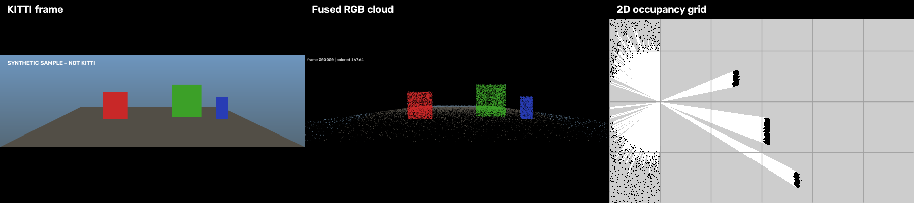
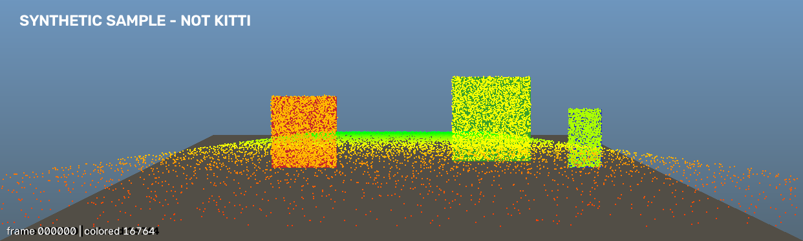
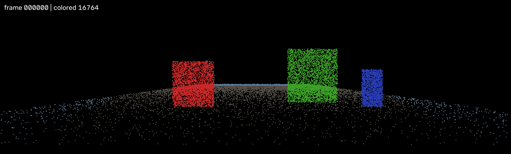
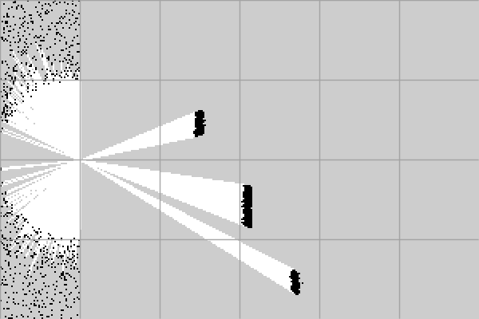

# 激光雷达-视觉空间融合管线

> **LiDAR-Vision Spatial Fusion Pipeline**
> 纯 C++ 离线处理框架：读取 KITTI，完成多模态早期融合、传感器退化评估，并输出轻量化 2D 占据栅格地图。

> **当前进度：M6 验证交付已完成（2026-11-07）**
> M0–M6 全部里程碑完成；`ctest` 17/17 通过；性能/内存、README、三联图、验收清单和 `v0.1.0` tag 已就绪。
> 验收记录见 [docs/acceptance.md](docs/acceptance.md)，性能见 [docs/performance.md](docs/performance.md)。



---

## 快速开始（M6）

```powershell
$cmake = "C:\Program Files (x86)\Microsoft Visual Studio\2022\BuildTools\Common7\IDE\CommonExtensions\Microsoft\CMake\CMake\bin\cmake.exe"
$pcl   = "C:\Users\ydyyy\Documents\deepseek-harness\default-workspace\_deps\pcl"
$cv    = "C:\Users\ydyyy\Documents\deepseek-harness\default-workspace\_deps\opencv\opencv\build"
$eigen = "C:\Users\ydyyy\Documents\deepseek-harness\default-workspace\_deps\pcl\3rdParty\Eigen3\share\eigen3\cmake"

& $cmake -S . -B build -G "Visual Studio 17 2022" -A x64 `
  "-DCMAKE_PREFIX_PATH=$pcl;$cv" `
  "-DEigen3_DIR=$eigen"

& $cmake --build build --config Release --parallel 8

powershell -ExecutionPolicy Bypass -File .\scripts\check_deps.ps1
powershell -ExecutionPolicy Bypass -File .\scripts\test.ps1
powershell -ExecutionPolicy Bypass -File .\scripts\check_data.ps1

# 一条命令：读取 + 退化评估 + 融合 + BEV 栅格 + 全部输出 + timing + summary
powershell -ExecutionPolicy Bypass -File .\scripts\run_pipeline.ps1

# 生成三联图（原图 | 融合点云 | 栅格）
python .\scripts\make_compare.py `
  --image .\data\sample\image_2\000000.png `
  --fused .\results\000000_fused_view.png `
  --grid .\results\000000_occupancy.png `
  --out .\results\000000_compare.png

# 可选开发工具
powershell -ExecutionPolicy Bypass -File .\scripts\inspect_frame.ps1
powershell -ExecutionPolicy Bypass -File .\scripts\fuse_frame.ps1
powershell -ExecutionPolicy Bypass -File .\scripts\build_map.ps1
powershell -ExecutionPolicy Bypass -File .\scripts\degradation_bench.ps1
```

当前已完成到 M6：`lidar_fusion` 一条命令产出融合点云、叠加图、退化 JSON、BEV PGM/YAML、栅格预览、单帧 timing 和 summary.csv；`make_compare.py` 生成 README 三联图。

### 性能摘要

| 指标 | 实测 |
|---|---:|
| compute 中位数（全输出） | 2.50 ms |
| end-to-end 中位数（全输出） | 43.98 ms |
| end-to-end p95（全输出） | 45.84 ms |
| 峰值 working set（10 帧） | 约 33 MB |

目标：compute ≤ 25 ms、end-to-end ≤ 50 ms；均达到。详见 [docs/performance.md](docs/performance.md)。

```text
.
├── CMakeLists.txt / CMakePresets.json
├── app/main.cpp                 # 应用入口
├── include/core/Types.h         # Calibration / Frame / GridMap / 配置
├── include/data/                # IDataSource / KittiCalibration / KittiDataSource
├── include/fusion/              # 投影核心、融合策略、策略工厂
├── include/degradation/         # 图像/点云退化评估、报告聚合
├── include/mapping/             # ROI/体素预处理、BEV 栅格
├── include/pipeline/            # 单帧端到端 Pipeline
├── include/viz/                 # OverlayRenderer / OccupancyMapRenderer
├── include/io/                  # PNG / PCD / JSON / PGM+YAML / timing 写出
├── include/utils/               # 日志
├── src/core/                    # Version / Types
├── src/data/                    # 标定解析 / KITTI 数据源
├── src/fusion/                  # 投影 / 取色 / 深度着色
├── src/degradation/             # 图像/点云检查、Evaluator
├── src/mapping/                 # 点云预处理 / BEV 占据栅格
├── src/pipeline/                # Pipeline 编排
├── src/viz/                     # 叠加图 / 融合点云 / 栅格预览
├── src/io/                      # 图像/PCD/JSON/PGM+YAML/timing writer
├── src/utils/                   # Log
├── tools/deps_check.cpp         # 依赖检查
├── tools/inspect_frame.cpp      # 单帧统计工具
├── tools/fuse_frame.cpp         # 单帧融合 + 退化评估
├── tools/degradation_bench.cpp  # 退化检查基准
├── tools/map_frame.cpp          # 单帧空间表征
├── tests/                       # 数据/融合/退化/地图/管线/PCD
├── scripts/                     # 构建、测试、管线、工具封装
├── data/sample/                 # 合成单帧样例（非真实 KITTI）
├── docs/                        # build / interfaces / 性能 / 验收 / M0-M6 验证
├── scripts/                     # 构建、测试、管线、对比图等
├── results/                     # 运行输出目录
├── .github/workflows/ci.yml     # Ubuntu CI（可选）
├── LICENSE                      # MIT（代码；KITTI 数据另许）
├── README.md
└── TASKS.md
```

---

## 1. 项目定位

一个**无硬件依赖**的离线 C++ 工程，围绕“感知 → 融合 → 空间表征”的底层链路展开：

```text
KITTI RGB + LiDAR + 标定
        ↓
  标定投影 / 早期融合
        ↓
  带 RGB 的 3D 点云 + 退化置信度
        ↓
  体素降采样 + 2D BEV Occupancy Grid
        ↓
  可供 A* / EGO-Planner 等规划器使用的地图
```

项目的重点不是训练模型，而是把自动驾驶/无人机感知中**最底层、最容易被“调包”掩盖**的几何链路自己写一遍：

- 相机内参、雷达外参、整流矩阵的矩阵组合；
- 3D 点云到 2D 像素的针孔投影；
- 图像与点云的早期融合；
- 传感器退化时的置信度评估与降级策略；
- 稠密点云到轻量栅格地图的空间表征。

---

## 2. 核心能力

### 2.1 多模态感知融合

- 不调用现成投影接口，手写 `P2 · R0_rect · Tr_velo_to_cam` 投影链路；
- 读取相机内参/雷达外参，将 3D 点云投影到 2D 像素；
- 用图像像素给点云上色，生成带 RGB 的 3D 点云；
- 输出投影叠加图，肉眼可检查标定是否贴合。

### 2.2 自主导航前置

- 将稠密 3D 点云降维、栅格化，生成 2D Occupancy Grid；
- 输出 `PGM + YAML`，语义上兼容 `map_server`，不引入 ROS 构建依赖；
- 栅格区分 `occupied / free / unknown`，可作为 A*、EGO-Planner 等规划器的输入；
- 完成“导航闭环”前 50% 的空间表征工作。

### 2.3 空间智能轻量化

- 在纯 C++ 中实现点云 ROI 裁剪、高度过滤、体素化（Voxelization）降采样；
- 模拟 Jetson Nano/Orin 等边缘设备算力受限时的“数据轻量化”流程；
- 记录单帧各阶段耗时，区分 compute 与 end-to-end，评估实时潜力。

---

## 3. 四大工程痛点与解决思路

| 痛点 | 解决思路 | 对应模块 |
|---|---|---|
| 视觉有语义没深度，LiDAR 有深度没语义 | 空间投影实现早期融合，生成带 RGB 的 3D 点云，让机器知道“前方 5 米是电线杆” | `ProjectionFusion` |
| 传感器退化导致系统崩溃 | 计算图像对比度/曝光、点云密度/角覆盖，输出各模态置信度与降级动作 | `DegradationCheck` |
| 海量点云无法直接用于机载避障 | 体素降采样 + 2D BEV 栅格化，把原始数据变成规划器看得懂的地图 | `SpatialMapper` |
| 无人机震动导致标定漂移 | 外参作为可配置输入；用投影叠加图可视化误差，便于替换/微调标定 | `DataInterface` + 可视化 |

---

## 4. 核心功能模块

| 模块 | 职责 | 关键产出 |
|---|---|---|
| `DataInterface` | 读取 KITTI RGB 图、`.bin` 点云、内外参 `.txt` | `Frame`、`Calibration` |
| `ProjectionFusion` | 针孔相机模型投影，3D → 2D，图像取色 | 带 RGB 的 `fused.pcd`、`overlay.png` |
| `DegradationCheck` | 图像直方图对比度、点云空间分布密度 | `degradation.json` |
| `SpatialMapper` | PCL 体素化降采样，2D BEV 栅格化 | `occupancy.pgm`、`occupancy.yaml` |

---

## 5. 技术关键点

- **设计模式**：抽象基类 `IDataSource` 隔离数据读取；策略模式 `IFusionStrategy` 切换正常融合/降级融合。
- **内存管理**：大点云统一用 `std::shared_ptr` / PCL `Ptr` 管理，禁止管线中裸 `new/delete`。
- **多线程**：主线程负责数据 IO；OpenMP 并行加速几十万点云的矩阵乘法、投影和取色。
- **工程构建**：现代 CMake，依赖 OpenCV（图像）+ Eigen（矩阵）+ PCL（点云）。
- **可测试性**：标定组合、投影边界、栅格行列方向都有单元测试；不靠“看图差不多”验收数学。

---

## 6. MVP 交付物

一条命令：

```powershell
powershell -ExecutionPolicy Bypass -File .\scripts\run_pipeline.ps1
```

输出：

```text
results/
├── 000000_fused.pcd          # 带 RGB 的 3D 点云（Velodyne 坐标）
├── 000000_overlay.png        # 原图 + 深度着色投影点
├── 000000_fused_view.png     # 投影后的彩色点云视图
├── 000000_occupancy.pgm      # 2D 占据栅格
├── 000000_occupancy.yaml     # 分辨率/原点/阈值
├── 000000_degradation.json   # 图像/点云置信度、action、map_trusted
├── 000000_timing.json        # 各阶段耗时
├── summary.csv               # 每帧汇总
└── 000000_compare.png        # 原图 | 融合点云 | 栅格图（M6）
```







M5 已把分散的工具收敛为一条 `lidar_fusion` 命令；M6 生成最终三联图和交付材料。

---

## 7. 任务拆解摘要

完整拆解见 **[TASKS.md](TASKS.md)**，包含 27 个任务的依赖、产出、实现要点和验收标准。

| 里程碑 | 内容 | 估时 |
|---|---|---:|
| M0 | ✅ 工程基线：依赖、CMake、样例数据 | 1.00 d |
| M1 | ✅ 数据接入：标定解析、RGB/.bin 读取 | 1.50 d |
| M2 | ✅ 投影融合：投影、OpenMP 取色、RGB 点云、可视化 | 2.00 d |
| M3 | ✅ 退化评估：图像/点云指标、置信度 JSON | 1.25 d |
| M4 | ✅ 空间表征：体素降采样、BEV 栅格、PGM/YAML | 2.00 d |
| M5 | ✅ 管线集成：CLI、耗时、集成测试 | 1.25 d |
| M6 | ✅ 验证交付：性能/内存、README、三联图、验收 | 1.75 d |
| **合计** | **27 个任务** | **约 10.75 人日** |

### 建议执行顺序

```text
T0.1 → T0.2 → T1.1 → T1.2 → T1.3 → T2.1 → T2.2 → T2.4
```

先做出第一张投影叠加图；这张图对不上，不往后写融合和栅格。

### 并行方式

- 1 人：按 M0 → M6 顺序推进，约 11 个工作日；
- 2 人：融合/集成 + 评估/地图/交付，约 6 个工作日；
- 3 人：融合、地图、退化/测试三条线，约 4–5 个工作日，但接口协调成本更高。

---

## 8. 验收标准摘要

### 功能

- [ ] 单帧命令成功，输出全部约定结果文件。
- [ ] 投影叠加图中点云边缘与图像物体边缘基本贴合。
- [ ] `fused.pcd` 带 RGB，可在 PCL/CloudCompare 中打开。
- [ ] 退化 JSON 能区分正常、暗光、稀疏三类输入。
- [ ] 栅格中道路 free、障碍 occupied、遮挡 unknown 可辨。
- [ ] `--all` 至少连续处理 3 帧。

### 工程

- [ ] C++17，干净目录可配置、可编译。
- [ ] `ctest` 全部通过；关键数学有单测。
- [ ] 无内存泄漏（ASan/Valgrind）。
- [ ] OpenMP 1/4 线程输出一致。
- [ ] 无硬编码绝对路径。

### 性能

- [ ] 单帧 compute 中位数 ≤ 25ms（目标）。
- [ ] 单帧 end-to-end ≤ 50ms（目标）。
- [ ] 记录硬件、编译选项、线程数；未达标需给出瓶颈分析。

---

## 9. 风险与默认假设

| 风险 | 应对 |
|---|---|
| PCL / OpenCV / Eigen 安装与版本冲突 | 当前使用 PCL 1.15.1 AllInOne + OpenCV 5.1.0 预编译包；固定版本，只链接 PCL `common/io/filters` |
| KITTI 标定矩阵顺序错 | 严格 `P2 · R0_rect · Tr_velo_to_cam`；合成点单测 + 叠加图 |
| 栅格行列/原点方向错 | 第 0 行对应 `y_max`，`origin` 为左下角；单点映射单测 |
| 地面点铺满栅格 | 高度过滤；可选 RANSAC 地面分割 |
| 25ms 目标达不到 | 分开统计 compute/end-to-end；`--no-viz` benchmark；优化写盘 |
| 范围蔓延 | 不做 ROS、SLAM、规划、深度学习、真实硬件驱动 |

默认假设：

- 当前已在 **Windows 11 + MSVC 2022** 上验证；WSL2 / Ubuntu 22.04 作为后续 CI 的补充环境；
- 数据使用 **KITTI object benchmark 单帧布局**；
- 地图输出 **PGM + YAML**，不引入 ROS 依赖；
- 先做单帧 MVP，再扩到小序列（≥3 帧）；
- 可视化落盘 PNG，不做 GUI。

如果实际要求不同，先改假设，再改代码。

---

## 10. 文件说明

| 文件 | 内容 |
|---|---|
| `README.md` | 项目总览、M6 快速开始、三联图、性能摘要、验收与假设 |
| `TASKS.md` | 27 个任务的完整拆解、接口契约、依赖图、排期、风险、输出格式 |
| `docs/build.md` | 依赖安装、CMake 配置、构建与排错 |
| `docs/interfaces.md` | 坐标系、数据所有权、IDataSource 契约 |
| `docs/m0-verification.md` | M0 实际环境、命令输出与验收证据 |
| `docs/m1-verification.md` | M1 标定/数据源测试结果与验收证据 |
| `docs/m2-verification.md` | M2 投影/融合/可视化/PCD 验收证据 |
| `docs/m3-verification.md` | M3 退化评估、JSON、性能基准与验收证据 |
| `docs/m4-verification.md` | M4 预处理、BEV 栅格、PGM/YAML 与验收证据 |
| `docs/m5-verification.md` | M5 Pipeline/CLI、timing、summary 与退出码验收 |
| `docs/performance.md` | 硬件、10 帧统计、线程扩展、峰值内存 |
| `docs/acceptance.md` | 最终验收清单与 v0.1.0 交付状态 |
| `docs/m6-verification.md` | M6 三联图、性能、repo polish 与 tag 记录 |
| `scripts/check_data.ps1` / `.sh` | 单帧数据布局校验 |
| `scripts/check_deps.ps1` | 自动拼运行时 PATH 并执行依赖检查 |
| `scripts/inspect_frame.ps1` | 自动注入运行时 PATH 并读取单帧统计 |
| `scripts/fuse_frame.ps1` | 自动注入运行时 PATH，执行退化评估 + 单帧融合 |
| `scripts/degradation_bench.ps1` | 退化检查热循环基准 |
| `scripts/build_map.ps1` | 自动注入运行时 PATH 并构建 BEV 栅格 |
| `scripts/run_pipeline.ps1` | 一条命令运行完整 Pipeline |
| `scripts/make_compare.py` | 生成原图 / 融合点云 / 栅格三联图 |
| `.github/workflows/ci.yml` | 可选 Ubuntu CI |
| `scripts/test.ps1` | 自动定位 ctest 并运行测试 |
| `LICENSE` | MIT（代码）；KITTI 数据另许 |

---

## 11. 一句话总结

**先对齐一张投影图，再谈融合；先跑通一帧，再谈性能；先把 PGM/YAML 和退化 JSON 落盘，再谈“导航闭环”。**
