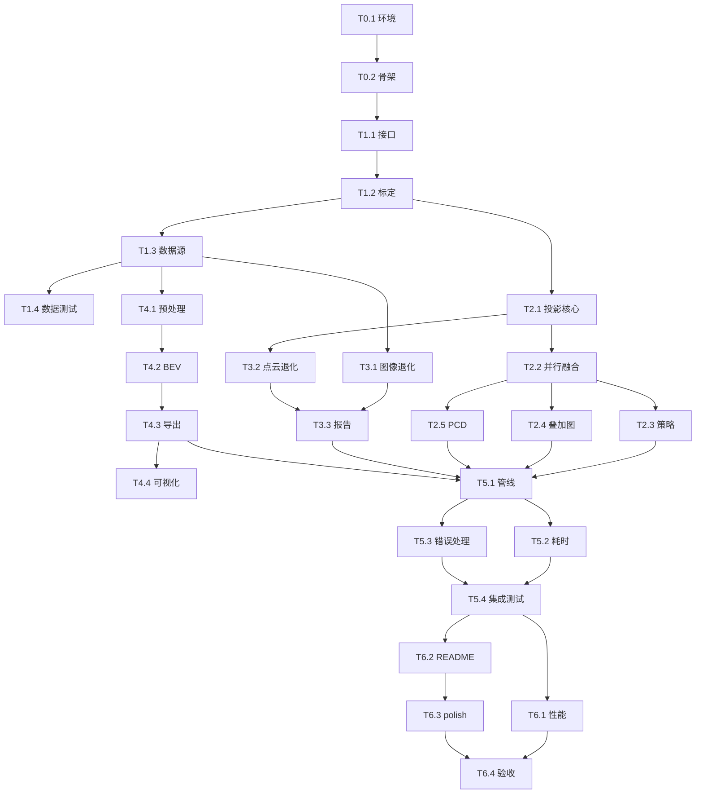

# LiDAR-Vision Spatial Fusion Pipeline — 任务拆解与执行计划

> 依据：项目方案截图（项目定位、四大痛点、四个核心模块、工程关键点、GitHub 仓库呈现）
> 目标：把方案落成 **可编译、可运行、可演示、可写进 README** 的单帧 MVP，再扩展到小序列。
> 规模：**7 个里程碑 / 27 个任务 / 约 10.75 人日**（不含环境安装等待）。
> 建议节奏：1 人约 11 个工作日；2 人并行约 6 个工作日。
> **进度：M6 已完成（2026-11-07）** — M0–M6 全部里程碑完成；CTest 17/17 通过；证据见 `docs/m6-verification.md`、`docs/acceptance.md`；tag `v0.1.0`。

---

## 0. 结论先行

这个项目最容易犯的错误，是先写一堆“看起来很架构”的类，最后卡在 KITTI 标定和 PCL 环境上。建议按下面的垂直切片推进：

```text
KITTI 单帧
  → 读取 RGB / .bin / calib
  → P2 · R0_rect · Tr_velo_to_cam 投影
  → 带 RGB 的 3D 点云 + 投影叠加图
  → 图像/点云置信度 JSON
  → 体素降采样 + 2D BEV Occupancy Grid（PGM + YAML）
  → 三联对比图 + 单帧耗时
```

**第一优先级不是“功能多”，而是先让一张投影图对上。** 投影一旦对齐，后面的融合、退化评估、栅格化都是增量工作；投影不对，后面全是返工。

**最大风险排序：**

1. PCL / OpenCV / Eigen 的版本与安装（尤其 Windows 原生环境）；
2. KITTI 坐标系与标定矩阵组合（`P2`、`R0_rect`、`Tr_velo_to_cam` 的顺序）；
3. Occupancy Grid 的行列方向、原点和 free/unknown 语义；
4. 25ms/帧的性能目标（PNG 解码、PCD 写盘往往比投影本身更耗时）；
5. 范围蔓延（SLAM、规划、深度学习、真实硬件都不在 MVP 内）。

---

## 1. 项目范围

### 1.1 MVP 必须包含

- [ ] 读取 KITTI 单帧：`image_2/*.png`、`velodyne/*.bin`、`calib/*.txt`。
- [ ] 解析 `P2`、`R0_rect`、`Tr_velo_to_cam`，完成 3D→2D 针孔投影。
- [ ] 用图像像素给点云上色，输出带 RGB 的 `.pcd`。
- [ ] 输出投影叠加图，肉眼可检查投影是否贴合。
- [ ] 计算图像对比度/曝光指标、点云密度/角覆盖率，输出置信度 JSON。
- [ ] PCL 体素降采样，生成 2D BEV Occupancy Grid。
- [ ] 输出 `PGM + YAML`（map_server 兼容）和栅格预览图。
- [ ] 一条命令跑完，输出单帧各阶段耗时。
- [ ] README 含构建、运行、架构、样例图、性能记录和局限说明。

### 1.2 明确不做（防止范围爆炸）

- 不做 ROS 节点、不做 `nav_msgs/OccupancyGrid` 消息收发（最多做格式兼容）。
- 不做 SLAM、建图闭环、回环检测。
- 不做 A*、EGO-Planner、避障控制。
- 不做深度学习语义分割；RGB 只作为颜色/语义附着，不引入模型推理。
- 不做真实相机/雷达驱动，不做硬件同步。
- 不做多传感器时间同步；MVP 假定同帧数据已对齐。
- 不做 GUI；可视化全部落盘为 PNG。

> v0.2 可选增强（不进 MVP）：外参交互式微调、RANSAC 地面分割、多帧栅格累积、ROS 1/2 wrapper、用 KITTI 标注做投影/栅格精度评估。

### 1.3 最终演示形态

```bash
./build/lidar_fusion \
  --data-root data/sample \
  --frame 000000 \
  --out results
```

生成：

```text
results/
├── 000000_fused.pcd
├── 000000_overlay.png
├── 000000_fused_view.png   # 投影后的彩色点云视图
├── 000000_occupancy.pgm
├── 000000_occupancy.yaml
├── 000000_degradation.json
├── 000000_timing.json
└── 000000_compare.png      # 原图 | 融合点云 | 栅格图
```

README 首屏放 `000000_compare.png`，再附一张 10 帧序列的耗时曲线或表格。

---

## 2. 技术基线

### 2.1 技术栈

| 项 | 选择 | 说明 |
|---|---|---|
| 语言 | C++17 | 使用 `std::filesystem`、`std::optional`、结构化绑定 |
| 构建 | CMake ≥ 3.16 | 现代 target-based CMake |
| 图像 | OpenCV ≥ 4.x | 读写 PNG、颜色采样、直方图、可视化 |
| 矩阵 | Eigen ≥ 3.3 | 标定矩阵组合、投影运算 |
| 点云 | PCL ≥ 1.10 | `VoxelGrid`、PCD IO；只链接 `common/io/filters` |
| 并行 | OpenMP | 点云投影循环并行 |
| 测试 | CTest + 轻量断言 | 不额外引入 GoogleTest/Catch2，减少依赖 |
| 可选 | ROS map_server | 仅用于验证 PGM/YAML 可被加载，不作为构建依赖 |

**环境建议：**

- 首选 Ubuntu 22.04 / WSL2：`libopencv-dev`、`libeigen3-dev`、`libpcl-dev`、`libomp-dev` 一条命令可装。
- Windows 原生：建议 vcpkg 统一管理，固定 triplet（如 `x64-windows`），避免 PCL 自带 Eigen 与系统 Eigen 冲突。
- 在 README 中记录实际验证过的版本，不要写“最新版”。

### 2.2 数据布局（MVP 约定）

为了不让数据源适配拖慢进度，MVP 先支持下面这种“单帧扁平布局”：

```text
data/sample/
├── image_2/
│   └── 000000.png
├── velodyne/
│   └── 000000.bin
└── calib/
    └── 000000.txt
```

`calib/000000.txt` 使用 KITTI object benchmark 格式，至少包含：

```text
P2: ...
R0_rect: ...          # 3x3
Tr_velo_to_cam: ...   # 3x4
```

如果后续要支持 KITTI Raw 的 `image_02/`、`velodyne_points/data/` 和日期级标定文件，新增一个 `IDataSource` 实现即可，不改管线。

### 2.3 坐标系约定（必须写进 README）

| 坐标系 | 轴向 | 用途 |
|---|---|---|
| Velodyne | x 向前，y 向左，z 向上 | 点云存储、BEV 栅格 |
| Camera | x 向右，y 向下，z 向前 | 投影计算 |
| Image | u 向右，v 向下 | 像素采样 |

投影链：

```text
T_img = P2 * R0_rect * Tr_velo_to_cam
uvw   = T_img * [x_v, y_v, z_v, 1]^T
u     = uvw.x / uvw.z
v     = uvw.y / uvw.z
有效条件：uvw.z > min_depth 且 0 <= u < W 且 0 <= v < H
```

**关键不变量：**

- 融合后的点云仍保存在 **Velodyne 坐标系**，不转成 Camera 坐标系。
- 只有“投影/取色”使用 Camera 坐标系；BEV 栅格始终使用 Velodyne 的 x-y 平面。
- 栅格图像第 0 行对应 `y_max`，`origin` 为左下角 `[x_min, y_min, 0]`，与 map_server 的约定保持一致；这一点必须有单元测试和 README 说明。
- 所有长度单位为米，所有耗时单位为毫秒。

---

## 3. 架构与接口契约

### 3.1 模块关系

```text
app/main.cpp (CLI)
  └── Pipeline
        ├── IDataSource            → KittiDataSource
        ├── IDegradationCheck      → ImageCheck + LidarCheck → DegradationReport
        ├── IFusionStrategy        → PinholeFusionStrategy / DepthOnlyFusionStrategy
        ├── SpatialMapper          → PCL VoxelGrid + BEV Grid
        └── IResultWriter          → PCD / PNG / PGM / YAML / JSON / CSV
```

### 3.2 建议先冻结的接口

先冻结接口，再并行开发，能显著减少“各写各的”造成的返工。

```cpp
using CloudXYZI  = pcl::PointCloud<pcl::PointXYZI>;
using CloudXYZRGB = pcl::PointCloud<pcl::PointXYZRGB>;

struct Calibration {
    Eigen::Matrix<float, 3, 4> P2;            // 投影矩阵
    Eigen::Matrix4f            R0_rect;       // 整流矩阵（补齐 4x4）
    Eigen::Matrix4f            T_velo_cam;    // 雷达到相机（补齐 4x4）

    Eigen::Matrix<float, 3, 4> veloToImage() const;
};

struct Frame {
    std::string id;
    cv::Mat image;                 // BGR8
    CloudXYZI::Ptr cloud;          // Velodyne 坐标
    Calibration calib;
};

class IDataSource {
public:
    virtual ~IDataSource() = default;
    virtual bool next(Frame& frame) = 0;
};

struct FusionResult {
    CloudXYZRGB::Ptr cloud;        // 仍为 Velodyne 坐标，带 RGB
    cv::Mat overlay;               // 投影叠加图
    std::size_t input_points = 0;
    std::size_t projected_points = 0;
    std::size_t colored_points = 0;
};

class IFusionStrategy {
public:
    virtual ~IFusionStrategy() = default;
    virtual FusionResult fuse(const Frame& frame) const = 0;
};

struct ModalityStatus {
    float confidence = 0.0f;
    bool degraded = false;
    std::vector<std::string> reasons;   // 稳定 code，便于测试
};

struct DegradationReport {
    ModalityStatus image;
    ModalityStatus lidar;
    float overall = 0.0f;
    std::string action;                  // FULL_FUSION / GEOMETRY_ONLY / ...
};

struct GridMap {
    int width = 0;
    int height = 0;
    float resolution = 0.2f;
    Eigen::Vector2f origin{0.0f, 0.0f};
    std::vector<int8_t> cells;           // -1 unknown, 0 free, 100 occupied
};
```

**设计要求：**

- `IDataSource` 用抽象基类隔离数据读取，KITTI 细节不进 `Pipeline`。
- `IFusionStrategy` 用策略模式切换融合算法；至少实现：
  - `PinholeFusionStrategy`：正常 RGB 上色；
  - `DepthOnlyFusionStrategy`：图像退化时只生成深度着色点云，仍可出栅格。
- 点云一律用 `std::shared_ptr` / PCL 的 `Ptr` 管理；禁止在管线中裸 `new/delete`。
  - 注意：PCL 的 `Ptr` 在部分版本是 `boost::shared_ptr`，部分版本是 `std::shared_ptr`。T0.1 固定 PCL 版本后，业务层统一使用该版本的 `Ptr` 别名；如果必须跨版本，写一层轻量适配，不要在同一接口里混用两种智能指针。
- `Frame` 按值传递时只复制 `cv::Mat` 头和 `shared_ptr`，不复制点云数据。

### 3.3 处理顺序

```text
读取一帧
  → 图像退化评估（不依赖投影）
  → 点云退化评估（距离/方位覆盖）
  → 融合策略选择（正常 / 仅几何）
  → 投影 + 取色 / 深度着色
  → 点云预处理（ROI、高度过滤、体素降采样）
  → BEV 栅格化（占据 + 射线标记 free + unknown）
  → 写出结果与耗时
```

退化评估放在融合之前，是为了让“降级策略”真正影响融合行为，而不是事后补一个报告。

---

## 4. 里程碑总览

| 里程碑 | 内容 | 任务 | 净估时 | 完成标志 |
|---|---|---|---:|---|
| M0 | 工程基线 | T0.1–T0.3 | 1.00 d | ✅ 已完成：可配置、可编译、依赖可链接 |
| M1 | 数据接入 | T1.1–T1.4 | 1.50 d | ✅ 已完成：单帧 RGB/点云/标定可读，5/5 测试通过 |
| M2 | 投影融合 | T2.1–T2.5 | 2.00 d | ✅ 已完成：投影叠加图、RGB 点云、PCD 落盘 |
| M3 | 退化评估 | T3.1–T3.3 | 1.25 d | ✅ 已完成：正常/暗光/稀疏置信度与 JSON |
| M4 | 空间表征 | T4.1–T4.4 | 2.00 d | ✅ 已完成：体素降采样 + PGM/YAML 栅格图 |
| M5 | 管线集成 | T5.1–T5.4 | 1.25 d | ✅ 已完成：一条命令产出全部结果 |
| M6 | 验证交付 | T6.1–T6.4 | 1.75 d | ✅ 已完成：测试、性能、README、tag |
| **合计** |  | **27 个任务** | **10.75 d** | 可演示 MVP |

> 估时是“熟悉 C++/OpenCV/PCL 的工程师净开发时间”，不含下载 KITTI、安装 PCL、等待 CI 的时间。实际排期建议乘 1.2–1.3 的缓冲。

---

## 5. 任务明细

### M0 — 工程基线（1.00 d）✅ 已完成

#### T0.1 锁定构建环境与依赖（0.50 d）✅ 已完成

- **依赖**：无。
- **产出**：
  - `docs/build.md`：Ubuntu/WSL2 与 Windows+vcpkg 两套安装命令；
  - `tools/deps_check.cpp`：打印 OpenCV/Eigen/PCL 版本，创建一个小矩阵、一个小点云、一个 `cv::Mat`，验证链接；
  - 版本矩阵（编译器、CMake、OpenCV、Eigen、PCL、OpenMP）。
- **实现要点**：
  - 先做“能编译并链接”的最小程序，不要等业务代码写完才发现 PCL 找不到。
  - 固定 C++17；MSVC 下注意 `/openmp` 与 PCL 的兼容。
  - 明确 PCL 只链接 `common io filters`，避免拉入可视化模块 `visualization`（VTK 依赖会显著增加安装成本）。
- **验收**：
  - 干净目录下 `cmake -S . -B build` 成功；
  - `cmake --build build` 成功；
  - `./build/deps_check` 输出各库版本且退出码为 0；
  - `docs/build.md` 按步骤可复现。
- **风险**：Windows 原生 PCL 安装失败 → 直接切 WSL2，不在环境上硬耗超过半天。

#### T0.2 仓库骨架与现代 CMake（0.25 d）✅ 已完成

- **依赖**：T0.1。
- **产出**：
  - 目录：`include/`、`src/`、`app/`、`tests/`、`data/`、`results/`、`docs/`、`tools/`；
  - `CMakeLists.txt`：`lidar_fusion_core`（静态库）、`lidar_fusion`（可执行）、`lidar_fusion_tests`（测试）；
  - `.gitignore`：忽略 `build/`、`results/*`、`data/kitti/`、大文件；
  - `README.md` 骨架（先放标题、构建占位）。
- **实现要点**：
  - 使用 `target_include_directories`、`target_link_libraries`、`target_compile_features`，不用全局 `include_directories`。
  - 开启 `-Wall -Wextra -Wpedantic`（MSVC 对应 `/W4`）。
  - `BUILD_TESTING` 选项默认 ON；测试用 `add_test` 注册。
- **验收**：
  - 空 `main()` 可编译运行；
  - `ctest --test-dir build --output-on-failure` 至少有一个 smoke test 通过；
  - 没有全局编译选项污染。
- **交付边界**：只搭骨架，不写业务逻辑。

#### T0.3 准备单帧样例与数据校验脚本（0.25 d）✅ 已完成

- **依赖**：无（可与 T0.1 并行）。
- **产出**：
  - `data/sample/` 下放一帧可复现样例：M0 使用 `scripts/make_sample_fixture.py` 生成合成 fixture；真实 KITTI 单帧按 `data/README.md` 替换；
  - `scripts/check_data.sh` / `.ps1`：检查三件套是否存在、`.bin` 字节数是否为 16 的倍数、calib 是否含 `P2/R0_rect/Tr_velo_to_cam`；
  - `data/README.md`：数据来源、许可、不要提交完整 KITTI。
- **验收**：
  - 脚本对完整样例返回 0，对缺文件样例返回非 0 并打印明确原因；
  - 仓库中不出现完整数据集。
- **注意**：KITTI 有独立许可，不要把大数据集提交到 GitHub；只保留一帧或给下载脚本。

---

### M1 — 数据接入（1.50 d）✅ 已完成

#### T1.1 核心类型与接口契约（0.25 d）✅ 已完成

- **依赖**：T0.2。
- **产出**：
  - `include/core/Types.h`：`Calibration`、`Frame`、`FusionResult`、`ModalityStatus`、`DegradationReport`、`GridMap`、`PipelineConfig`；
  - `include/data/IDataSource.h`、`include/fusion/IFusionStrategy.h`；
  - `docs/interfaces.md`：字段含义、坐标系、所有权约定。
- **验收**：
  - 所有头文件可被单独 include（自包含）；
  - `Frame` 拷贝不触发点云深拷贝；
  - 接口不依赖具体 KITTI/PCL 实现细节（PCL 类型可保留，但读取实现不暴露）。
- **注意**：这个任务是并行开发的地基，**先冻结，后写实现**；后续改接口要同步改所有分支。

#### T1.2 KITTI 标定解析与矩阵组合（0.50 d）✅ 已完成

- **依赖**：T1.1。
- **产出**：
  - `include/data/KittiCalibration.h`、`src/data/KittiCalibration.cpp`；
  - `tests/test_calibration.cpp`；
  - 解析 `P2`、`R0_rect`、`Tr_velo_to_cam`；补 4x4；实现 `veloToImage()`；
  - 支持从外部标定文件加载（`--calib`），外参不硬编码，为“无人机震动导致标定漂移”的演示留出入口。
- **实现要点**：
  - 逐行读取 `key:` 后的数值，兼容多空格、负号、科学计数法；
  - `R0_rect` 是 3x3，补成 `[R0 0; 0 1]`；
  - `Tr_velo_to_cam` 是 3x4，补成 `[R t; 0 1]`；
  - 组合顺序必须为 `P2 * R0_rect * T_velo_cam`，不要写成 `T_velo_cam * R0_rect * P2`；
  - KITTI 的 `P2` 已经包含相机内参与投影信息；若界面上要显示 `K`，提取 `P2.leftCols<3>()` 即可，但实际投影仍直接用 `P2`，不要重复乘内参；
  - 检查矩阵是否有限；`P2` 第三行前两列应接近 0、第三列接近 1，`P2(2,3)` 是 KITTI 的小量（常见约 `2.7e-3`），不要用严格等于 0 去判断。
- **验收**：
  - 用合成数据测试：相机前方点 `(0,0,10)` 投影到主点附近；
  - 点位于相机后方时被过滤；
  - 缺 key、维度不对、含 `nan` 时抛出明确异常；
  - 与手算结果误差 < 1e-4。
- **风险**：这是全项目最容易错的一步；不要靠“看图差不多”验收，必须有数值单测。

#### T1.3 KittiDataSource：RGB + .bin + calib（0.50 d）✅ 已完成

- **依赖**：T1.2。
- **产出**：
  - `include/data/KittiDataSource.h`、`src/data/KittiDataSource.cpp`；
  - `tests/test_kitti_source.cpp`；
  - 支持 `--data-root` 下的 `image_2/`、`velodyne/`、`calib/` 布局；按帧号补零。
- **实现要点**：
  - 图像：`cv::imread(path, cv::IMREAD_COLOR)`，检查 `empty()`；
  - 点云：二进制读取，每条 4 个 `float`（x, y, z, intensity）；检查文件大小 `% 16 == 0`；
  - 使用 `std::filesystem` 检查路径，错误信息包含期望路径；
  - `next(Frame&)` 读取当前帧并推进；支持单帧和连续帧；
  - 点云用 `std::make_shared<CloudXYZI>()`，`resize(n)` 后逐点填。
- **验收**：
  - 样例帧返回图像尺寸、点云点数、标定矩阵；
  - `.bin` 截断/空文件/缺 calib 时抛出可读异常；
  - 连续读取 3 帧，帧号正确；
  - 单帧读取耗时记录（不强制阈值）。

#### T1.4 数据接入测试与样例统计（0.25 d）✅ 已完成

- **依赖**：T1.3。
- **产出**：
  - `tools/inspect_frame.cpp` 或测试用例：打印图像尺寸、点云点数、距离范围、强度范围、`T_img`；
  - `tests/test_data_integration.cpp`。
- **验收**：
  - 对样例数据输出合理统计（如点数 > 10k、图像非空、深度范围覆盖 1–80m）；
  - 在 CI/本地无样例数据时，测试自动跳过并给出提示，不误报失败。

---

### M2 — 投影融合（2.00 d）✅ 已完成

#### T2.1 投影核心：3D → 2D（0.50 d）✅ 已完成

- **依赖**：T1.2。
- **产出**：
  - `include/fusion/Projection.h`、`src/fusion/Projection.cpp`；
  - `tests/test_projection.cpp`；
  - 纯 Eigen/OpenCV 实现，不依赖 PCL 点云类型（输入可以是 `Eigen::Vector3f` 或轻量数组）。
  - **“不调包”的边界**：投影公式自己写，不调用 `cv::projectPoints` 或 PCL 的投影接口；Eigen 只负责矩阵存储与乘法，OpenCV 只负责图像 IO/采样/可视化。
- **实现要点**：
  - 预计算 `T_img`，避免每个点重复乘 `P2 * R0 * T`；
  - 齐次变换：`uvw = T_img * [x,y,z,1]`；
  - 过滤 `uvw.z <= min_depth`、`u/v` 越界、`depth > max_depth`；
  - 提供 `projectPoint()` 和批量 `projectPoints()` 两个入口，后者为 OpenMP 做准备；
  - 返回结构化结果：`valid`、`u`、`v`、`depth`、`camera_xyz`。
- **验收**：
  - 合成标定 `fx=fy=100, cx=50, cy=40`，点 `(0,0,10)` → `(50,40)`；
  - 边界点、负深度、远距离点测试；
  - 批量与单点结果逐点一致（误差 < 1e-5）；
  - 单帧 12 万点投影核心耗时 < 2ms（Release，单线程）。

#### T2.2 OpenMP 并行取色与融合（0.50 d）✅ 已完成

- **依赖**：T2.1。
- **产出**：
  - `include/fusion/PinholeFusion.h`、`src/fusion/PinholeFusion.cpp`；
  - `tests/test_fusion.cpp`；
  - 并行投影 + 双线性采样 + 生成 `CloudXYZRGB`。
- **实现要点**：
  - **不要在并行循环里 `push_back` 或加锁**；预分配 `N` 个点 + `valid` 掩码，循环写不同下标，最后串行压缩；
  - 双线性采样注意图像边界 clamp；
  - BGR → RGB 转换不要写反；
  - 无效投影点丢弃；统计 `input/projected/colored` 三个数；
  - OpenMP 线程数可配置，默认 `omp_get_max_threads()`；
  - 保证 1/2/4/8 线程输出逐点一致（浮点采样位置用同一套计算）。
- **验收**：
  - 合成 3x3 图像 + 已知投影点，RGB 值正确；
  - 同一帧 1 线程与 4 线程输出 PCD 的 RGB/坐标完全一致；
  - 12 万点取色 + 融合核心 < 5ms（Release，4 线程，不含写盘）；
  - 无数据竞争（TSan 或至少代码审查 + 重复运行比对）。

#### T2.3 策略模式与降级策略（0.25 d）✅ 已完成

- **依赖**：T1.1、T2.2。
- **产出**：
  - `include/fusion/IFusionStrategy.h`（T1.1 已定义，补实现）；
  - `PinholeFusionStrategy`、`DepthOnlyFusionStrategy`、`FusionStrategyFactory`；
  - `tests/test_strategy.cpp`。
- **实现要点**：
  - 正常：图像取色；
  - 图像退化：不取色，按深度生成伪彩色，保证仍能输出点云与栅格；
  - 工厂根据 `DegradationReport.action` 和配置选择策略；
  - 策略对象无状态或只读配置，可复用。
- **验收**：
  - 同一帧切换策略，输出点数一致、颜色模式不同；
  - 非法策略名返回明确错误；
  - 策略选择有日志，便于演示。

#### T2.4 投影叠加图、融合点云视图与视觉检查（0.50 d）✅ 已完成

- **依赖**：T2.2。
- **产出**：
  - `include/viz/OverlayRenderer.h`、`src/viz/OverlayRenderer.cpp`；
  - `results/<frame>_overlay.png`：原图 + 投影点；
  - `results/<frame>_fused_view.png`：空白画布 + 带 RGB 的点云投影（三联图中间那张）；
  - `tests/test_overlay.cpp`（尺寸/非空/颜色范围即可，不做像素级 golden）。
- **实现要点**：
  - 在原图上按深度着色画投影点；远近距离用 `cv::applyColorMap` 或自定义 jet；
  - 12 万点逐点 `cv::circle` 可能慢；优先直接写像素或每 N 个点采样；
  - `fused_view` 不需要 3D 引擎：复用 `(u,v,depth)` 直接 splat 到画布，按深度从远到近绘制，或用简单 z-buffer，就能得到“投影后彩色点云”效果，避免引入 PCL `visualization`/VTK；
  - 画一个图例/文字：帧号、有效投影点数、耗时；
  - 输出 BGR PNG，确保用图片查看器打开颜色正确。
- **验收**：
  - 叠加图中点云边缘与图像物体边缘基本贴合（人工检查）；
  - `fused_view.png` 能看出场景轮廓和颜色，不是全黑；
  - 两张图尺寸与原图一致；
  - 生成耗时 < 10ms（可关闭）。
- **注意**：这是最早能“看到成果”的任务，建议优先做，能快速暴露标定错误。

#### T2.5 带 RGB 点云落盘（0.25 d）✅ 已完成

- **依赖**：T2.2。
- **产出**：
  - `src/io/PcdWriter.cpp`；
  - `results/<frame>_fused.pcd`；
  - `tests/test_pcd_roundtrip.cpp`。
- **实现要点**：
  - `pcl::PCDWriter` 写 binary，字段包含 `x y z rgb`；
  - 写完后用 `pcl::io::loadPCDFile` 读回，校验点数与若干点的 RGB；
  - PCD 中保持 Velodyne 坐标，不要偷偷转相机坐标；
  - 文件较大时用 binary，不用 ASCII。
- **验收**：
  - PCD 可被 PCL 读回；
  - 点数等于 `colored_points`；
  - 随机抽 10 个点，RGB 与内存中一致；
  - 文件头 `FIELDS x y z rgb` 正确。

---

### M3 — 退化评估（1.25 d）✅ 已完成

#### T3.1 图像退化指标（0.50 d）✅ 已完成

- **依赖**：T1.3（只需要图像）。
- **产出**：
  - `include/degradation/ImageDegradationCheck.h`、`src/degradation/ImageDegradationCheck.cpp`；
  - `tests/test_image_degradation.cpp`；
  - 指标：灰度均值、标准差、直方图熵、暗像素比例、过曝像素比例。
- **实现要点**：
  - `cv::cvtColor(BGR2GRAY)`；
  - 直方图 256 bins，熵归一化到 `[0,1]`；
  - 暗像素阈值建议 20–25，过曝阈值 230–235，写入配置；
  - 置信度建议：`0.5*contrast + 0.3*entropy + 0.2*exposure`，阈值 0.35，全部可配置；
  - 输出稳定 code：`LOW_CONTRAST`、`DARK_IMAGE`、`OVEREXPOSED`、`LOW_ENTROPY`。
- **验收**：
  - 合成全黑、全白、低对比度、正常纹理四类图，置信度排序合理；
  - 暗图触发 `DARK_IMAGE`，过曝图触发 `OVEREXPOSED`；
  - 指标值与手算/OpenCV 参考值一致；
  - 1242×375 图像评估 < 2ms。

#### T3.2 点云退化指标（0.50 d）✅ 已完成

- **依赖**：T1.3、T2.1（复用投影/FOV 判断，或独立算距离/方位）。
- **产出**：
  - `include/degradation/LidarDegradationCheck.h`、`src/degradation/LidarDegradationCheck.cpp`；
  - `tests/test_lidar_degradation.cpp`；
  - 指标：近场点数（<30m）、距离分桶点数、方位角覆盖 bin 数、FOV 内点数。
- **实现要点**：
  - 以 Velodyne 原点为中心，`range = sqrt(x²+y²)`，`azimuth = atan2(y,x)`；
  - 方位角分成 36 个 10° bin，统计非空 bin / 36 作为角覆盖率；
  - 密度分：`min(1, near_points / expected_near_points)`，`expected_near_points` 配置默认 20000；
  - 置信度建议：`0.6*density + 0.4*coverage`，阈值 0.4；
  - code：`SPARSE_POINTS`、`LOW_COVERAGE`、`EMPTY_CLOUD`。
- **验收**：
  - 稠密样例置信度高；抽稀到 5% 后显著下降；
  - 空点云返回 `EMPTY_CLOUD` 且置信度 0；
  - 单帧评估 < 2ms；
  - 阈值可通过配置覆盖。

#### T3.3 报告聚合与 JSON 输出（0.25 d）✅ 已完成

- **依赖**：T3.1、T3.2。
- **产出**：
  - `include/degradation/DegradationReport.h`（类型已在 T1.1）；
  - `src/io/DegradationJsonWriter.cpp`；
  - `results/<frame>_degradation.json`；
  - `tests/test_degradation_report.cpp`。
- **实现要点**：
  - `overall = 0.5*image + 0.5*lidar`；
  - `action` 取值：
    - `FULL_FUSION`：两模态都正常；
    - `GEOMETRY_ONLY`：图像退化、雷达正常；
    - `IMAGE_ONLY`：雷达退化、图像正常（栅格不可信，标注警告）；
    - `BOTH_DEGRADED`：两者都退化（默认继续输出，但标记 `map_trusted=false`）。
  - JSON 字段稳定，便于后续脚本消费；
  - 控制台同时打印一行摘要。
- **验收**：
  - 正常/暗光/稀疏三个样例生成不同 `action`；
  - JSON 可被 `python -m json.tool` 解析；
  - 字段缺失时有默认值，不崩溃；
  - README 附 JSON 示例。

---

### M4 — 空间表征（2.00 d）✅ 已完成

#### T4.1 点云预处理与体素降采样（0.50 d）✅ 已完成

- **依赖**：T1.3。
- **产出**：
  - `include/mapping/PointCloudPreprocessor.h`、`src/mapping/PointCloudPreprocessor.cpp`；
  - `tests/test_preprocess.cpp`；
  - ROI 裁剪、高度过滤、PCL `VoxelGrid` 降采样。
- **实现要点**：
  - ROI 默认：`x ∈ [-10, 50]`，`y ∈ [-20, 20]`，`z ∈ [-1.5, 2.5]`（Velodyne，米）；
  - **必须做高度过滤**，否则地面点会把 BEV 铺满；KITTI 地面大约在 `z ≈ -1.7m`，默认下限 `-1.5` 可滤掉大部分地面，但需在 README 说明这是近似；
  - PCL `VoxelGrid<pcl::PointXYZI>`，leaf size 默认 0.2m；
  - 保留强度字段；
  - 输出统计：输入点数、ROI 内点数、降采样后点数、耗时。
- **验收**：
  - 合成点云：ROI 外点被删、地面点被删、体素内多点合并；
  - 降采样后点数 ≤ 输入点数；
  - 单帧 12 万点预处理 + 体素化 < 10ms；
  - 参数可配置，不硬编码。

#### T4.2 2D BEV 占据栅格（0.75 d）✅ 已完成

- **依赖**：T4.1、T1.1 的 `GridMap`。
- **产出**：
  - `include/mapping/BevOccupancyGrid.h`、`src/mapping/BevOccupancyGrid.cpp`；
  - `tests/test_bev_grid.cpp`；
  - 栅格坐标映射、占据标记、射线 free-space 标记、unknown。
- **实现要点**：
  - 分辨率默认 0.2m；`width = ceil((x_max-x_min)/res)`，`height = ceil((y_max-y_min)/res)`；
  - 映射：
    ```cpp
    col = floor((x - x_min) / resolution);
    row = floor((y_max - y) / resolution);   // 第 0 行 = y_max
    ```
  - 初始化 `-1`（unknown）；有点的 cell 置 `100`（occupied）；
  - **射线投射**：对每个 occupied cell，从原点 cell 到该 cell 做 2D Bresenham，途经 cell 若不是 occupied 则置 `0`（free）；这样能生成可被规划器使用的 free space，而不是只有障碍点；
  - 可选膨胀：`--inflation 0.3`，按栅格半径膨胀 occupied，默认关闭或 1 格，README 说明；
  - 统计：occupied 数、free 数、unknown 数、占据比例。
- **验收**：
  - 单点 `(0,0)` 落在预期行列；
  - 前方障碍物的射线路径被标记 free，障碍物后方保持 unknown；
  - 栅格尺寸/原点与配置一致；
  - 12 万点 → 5 万体素 → 栅格化 + 射线 < 15ms；
  - 有单测覆盖行列方向和 y 翻转。

#### T4.3 PGM + YAML 导出（0.50 d）✅ 已完成

- **依赖**：T4.2。
- **产出**：
  - `src/io/OccupancyMapWriter.cpp`；
  - `results/<frame>_occupancy.pgm`、`<frame>_occupancy.yaml`；
  - `tests/test_map_io.cpp`。
- **实现要点**：
  - PGM 用 `P5` 二进制，8-bit；
  - 值约定：`0 = occupied`、`254 = free`、`205 = unknown`；
  - YAML 至少包含：
    ```yaml
    image: 000000_occupancy.pgm
    resolution: 0.2
    origin: [-10.0, -20.0, 0.0]
    negate: 0
    occupied_thresh: 0.65
    free_thresh: 0.196
    ```
  - 可追加自定义字段：`frame_id: velodyne`、`height_min`、`height_max`、`raycast: true`；map_server 会忽略未知字段；
  - 写完后读回 PGM 头，校验宽高与 `GridMap` 一致；
  - 同时输出 `<frame>_occupancy.png` 便于 README 展示（放大/最近邻，别插值糊掉栅格）。
- **验收**：
  - PGM 头 `P5 width height 255` 正确；
  - 像素数量 = width × height；
  - YAML 可被 `python yaml.safe_load` 解析（开发环境有 PyYAML 时）；
  - 若环境有 ROS，`map_server` 能加载（可选验证，不阻塞）；
  - 行列方向与 T4.2 单测一致。

#### T4.4 栅格可视化与质量统计（0.25 d）✅ 已完成

- **依赖**：T4.3。
- **产出**：
  - `results/<frame>_occupancy.png`（或并入 `compare.png`）；
  - `results/<frame>_grid_stats.json`（可选，也可并入 timing/degradation）；
  - README 中的栅格图说明。
- **实现要点**：
  - occupied 黑色、free 白色、unknown 灰色；
  - 叠加 10m 网格线/距离环，方便看尺度；
  - 统计 occupied/free/unknown 比例，异常时打印警告（如 occupied > 60%）。
- **验收**：
  - 图上能看出道路 free、障碍 occupied、遮挡 unknown；
  - 比例统计与 `GridMap` 数据一致；
  - 图片尺寸与栅格一致或整数倍放大。

---

### M5 — 管线集成（1.25 d）✅ 已完成

#### T5.1 Pipeline 编排与 CLI（0.50 d）✅ 已完成

- **依赖**：T2.3、T2.4、T2.5、T3.3、T4.3。
- **产出**：
  - `include/pipeline/Pipeline.h`、`src/pipeline/Pipeline.cpp`；
  - `app/main.cpp`；
  - `include/core/PipelineConfig.h`；
  - CLI 参数解析（不引入 boost/program_options，手写即可）。
- **CLI 建议**：
  ```text
  --data-root <dir>       必填
  --frame <id>            单帧，默认 000000
  --all                   处理目录下所有帧
  --calib <file>          可选，覆盖默认 calib 路径，用于演示外参漂移
  --out <dir>             默认 results
  --resolution <m>        默认 0.2
  --voxel <m>             默认 0.2
  --x-min/--x-max/--y-min/--y-max/--z-min/--z-max
  --min-depth <m>         默认 0.5
  --max-depth <m>         默认 80
  --threads <n>           默认硬件线程
  --no-viz                跳过 overlay/compare，便于 benchmark
  --no-raycast            关闭 free-space 射线标记
  --fail-on-degraded      退化时返回非 0（默认关闭）
  --help
  ```
- **实现要点**：
  - `Pipeline::run(frame)` 返回结构化结果与耗时；
  - 单帧失败不静默；批量模式可选择“跳过并继续”；
  - 输出目录自动创建；
  - 所有路径用 `std::filesystem`。
- **验收**：
  - `--help` 可读；
  - 单帧命令退出码 0，产出全部文件；
  - 缺参数/路径错误时退出码非 0 且信息明确；
  - 批量模式至少处理 3 帧。

#### T5.2 耗时采集与结果目录（0.25 d）✅ 已完成

- **依赖**：T5.1。
- **产出**：
  - `include/utils/Stopwatch.h`；
  - `results/<frame>_timing.json`、`results/summary.csv`；
  - 各阶段耗时：read、degradation、fusion、mapping、write、total。
- **实现要点**：
  - 用 `std::chrono::steady_clock`；
  - 批量模式输出每帧一行 CSV，列固定；
  - 计算 mean/median/p95（小序列即可）；
  - 区分 `compute_ms`（不含写盘）与 `end_to_end_ms`，否则性能数字会误导。
- **验收**：
  - JSON/CSV 可解析；
  - 各阶段耗时之和与 total 误差 < 5%（允许计时开销）；
  - README 引用实测数据。

#### T5.3 错误处理、日志与退出码（0.25 d）✅ 已完成

- **依赖**：T5.1。
- **产出**：
  - `include/utils/Log.h`（INFO/WARN/ERROR）；
  - 统一异常捕获；
  - 退出码约定：0 成功、1 参数/IO 错误、2 数据处理错误、3 退化阻断（仅 `--fail-on-degraded`）。
- **实现要点**：
  - 异常信息包含文件路径和阶段名；
  - 不吞异常；不打印堆栈给最终用户；
  - 退化但继续时打印 `[WARN]` 和 `action`。
- **验收**：
  - 缺图像、坏 `.bin`、空点云、输出目录不可写四类错误均能给出明确信息；
  - 不会产生半截文件（先写临时文件再 rename，或失败时清理）。

#### T5.4 端到端集成测试（0.25 d）✅ 已完成

- **依赖**：T5.1–T5.3。
- **产出**：
  - `tests/test_pipeline_e2e.cpp` 或 CTest 脚本；
  - 运行一条完整命令，检查约定的全部输出文件存在且非空。
- **验收**：
  - `ctest` 中集成测试通过（有样例数据时）；
  - PCD 点数 > 0、PGM 尺寸 > 0、JSON 可解析；
  - 连续跑两次结果一致（除时间戳/耗时字段）。
- **注意**：集成测试不要依赖网络；样例数据放仓库或由环境变量指定。

---

### M6 — 验证与交付（1.75 d）✅ 已完成

#### T6.1 性能与内存验证（0.50 d）✅ 已完成

- **依赖**：T5.4。
- **产出**：
  - `docs/performance.md`：硬件、编译选项、单帧/10 帧的 mean/median/p95；
  - 线程扩展表：1/2/4/8 线程的 fusion 耗时；
  - ASan/Valgrind 或 MSVC ASan 报告；
  - 可选 `--benchmark` 模式：循环处理不写盘。
- **实现要点**：
  - **分别报告 compute 与 end-to-end**；PNG/PCD 写盘通常占大头；
  - 关闭 `--no-viz` 测一次，开启再测一次；
  - 首次运行有缓存/预热影响，至少 warmup 3 帧再计时；
  - 内存检查跑 10 帧，确认无泄漏、无持续增长；
  - 如果 25ms 未达标，记录瓶颈（读图/写 PCD/体素化/射线），不要只写“未达标”。
- **验收**：
  - 有可复现的命令和数字；
  - 无内存泄漏；
  - 线程数增加时 fusion 有加速（不必线性）；
  - README 引用该文档。

#### T6.2 README 与三联对比图（0.75 d）✅ 已完成

- **依赖**：T5.4、T4.4、T2.4。
- **产出**：
  - 完整 `README.md`；
  - `results/<frame>_compare.png`：左原图、中融合点云、右栅格图；
  - 架构图（Mermaid 或手绘 PNG）；
  - 构建/运行/参数/输出说明；
  - “设计取舍与局限”一节。
- **README 建议结构**：
  1. 项目一句话 + 三联图；
  2. 解决的四个问题（对应方案原文）；
  3. 架构与数据流；
  4. 快速开始（依赖、构建、运行）；
  5. 输出说明（PCD/PGM/YAML/JSON）；
  6. 关键实现（标定、OpenMP、策略模式、shared_ptr）；
  7. 性能记录；
  8. 局限与后续（未做 ray casting 的部分、未做时序同步等）；
  9. 数据许可与致谢。
- **验收**：
  - 新机器按 README 能构建运行；
  - 三联图能清楚看出“原图 / 彩色点云 / 栅格”；
  - 不夸大为“实时自动驾驶系统”，明确是离线 MVP。
- **注意**：README 是这个项目最重要的“作品集界面”，不要最后一天草草写。

#### T6.3 仓库 polish 与可选 CI（0.25 d）✅ 已完成

- **依赖**：T6.2。
- **产出**：
  - `.clang-format`；
  - GitHub Actions（可选）：Ubuntu 安装依赖、build、ctest；
  - `LICENSE`（如 MIT，注意 KITTI 数据另许）；
  - 清理调试输出、死代码、未使用参数。
- **验收**：
  - `clang-format --dry-run --Werror` 通过（或至少格式统一）；
  - CI 绿（如果启用）；
  - 仓库无大文件、无密钥、无本地绝对路径。

#### T6.4 最终验收与打 tag（0.25 d）✅ 已完成

- **依赖**：T6.1–T6.3。
- **产出**：
  - `docs/acceptance.md`：逐条勾选 DoD；
  - git tag `v0.1.0`；
  - 一页“演示脚本”（讲什么、打开哪张图、强调哪些指标）。
- **验收**：
  - 下面第 7 节清单全部通过；
  - 从干净 clone 到跑通不超过 15 分钟（不含依赖安装）。

---

## 6. 并行拆分与排期

### 6.1 依赖图



### 6.2 单人顺序

```text
M0 → M1 → M2 → M3 → M4 → M5 → M6
```

约 11 个工作日。建议 M2 的 T2.4（叠加图）提前到 T2.2 之后立刻做，尽早获得视觉反馈。

### 6.3 两人并行（推荐）

| 角色 | 负责 | 说明 |
|---|---|---|
| A：融合/集成 | T0.2、T1.1、T1.2、T1.3、T2.1–T2.5、T5.1–T5.3 | 掌握标定与主链路 |
| B：评估/地图/交付 | T0.1、T0.3、T1.4、T3.1–T3.3、T4.1–T4.4、T5.4、T6.1、T6.2 | 与 A 在 T1.1 后分叉 |
| 共同 | T6.3、T6.4 | 代码审查、最终验收 |

- 第 1 天：A 做 T0.2/T1.1/T1.2，B 做 T0.1/T0.3；两人一起确认样例数据。
- 第 2 天：A 做 T1.3/T2.1/T2.2，B 做 T1.4/T3.1/T4.1。
- 第 3 天：A 做 T2.3/T2.4/T2.5，B 做 T3.2/T3.3/T4.2。
- 第 4 天：B 做 T4.3/T4.4；A 先搭 T5.1 的 CLI/配置骨架，等 T4.3 合并后接上地图输出，再做 T5.2。
- 第 5 天：A 做 T5.3；B 做 T5.4/T6.1；两人一起做 T6.2（三联图 + README）。
- 第 6 天：README 打磨、T6.3/T6.4、演示彩排。

**并行约束：**

- T1.1 接口必须先合并，否则 A/B 的 `Frame`/`GridMap` 会对不上。
- 共用 `results/` 时按帧号命名，避免互相覆盖。
- 所有 PR 必须自己跑过 `ctest`；不要等集成时才发现编译不过。

### 6.4 三人并行（可选）

- A：T2 融合 + T5 集成；
- B：T4 地图 + T6.1 性能；
- C：T3 退化 + T1 数据 + 测试/README。
- 约 4–5 个工作日，但接口协调成本更高；不建议在 MVP 阶段过度拆人。

---

## 7. 验收清单（Definition of Done）

### 7.1 功能

- [ ] 单帧命令成功，退出码 0。
- [ ] 输出 `fused.pcd`、`overlay.png`、`fused_view.png`、`occupancy.pgm`、`occupancy.yaml`、`degradation.json`、`timing.json`、`compare.png`。
- [ ] 投影叠加图中点云与图像物体边缘基本贴合。
- [ ] PCD 带 RGB，且可在 PCL/CloudCompare 中打开。
- [ ] 退化 JSON 能区分正常、暗光、稀疏三类输入。
- [ ] PGM/YAML 尺寸、分辨率、原点正确；栅格中道路 free、障碍 occupied、遮挡 unknown 可辨。
- [ ] `--all` 至少能连续处理 3 帧。
- [ ] 参数错误、文件缺失、空点云均有明确报错。

### 7.2 工程

- [ ] C++17，CMake 从干净目录可配置。
- [ ] `-Wall -Wextra -Wpedantic` 无警告（或已记录豁免）。
- [ ] `ctest` 全部通过；无样例数据时集成测试正确 skip。
- [ ] 无裸 `new/delete` 管理点云；无内存泄漏（ASan/Valgrind）。
- [ ] OpenMP 输出在 1/4 线程下一致；无线程数相关的崩溃。
- [ ] 关键数学有单元测试：标定组合、投影边界、栅格行列。
- [ ] 代码中无硬编码绝对路径；路径由 CLI 传入。

### 7.3 性能

- [ ] 单帧 **compute**（read + degradation + fusion + mapping，不含写盘）中位数 ≤ 25ms（目标）。
- [ ] 单帧 **end-to-end**（含 PNG/PCD 写盘）≤ 50ms（目标）。
- [ ] 记录测试硬件、编译选项、线程数、warmup 次数。
- [ ] 若未达标，`docs/performance.md` 给出瓶颈分析与下一步优化，而不是只写“未达标”。
- [ ] 12 万点单帧内存峰值有记录（可用 `/usr/bin/time -v` 或任务管理器）。

### 7.4 交付

- [ ] README 首屏有三联图。
- [ ] README 有构建、运行、输出、局限、许可。
- [ ] `docs/performance.md`、`docs/acceptance.md` 完成。
- [ ] `v0.1.0` tag。
- [ ] 演示脚本能在 5 分钟内讲清“输入→融合→栅格→导航输入”。

---

## 8. 需求追踪矩阵

| 方案原文要点 | 落地任务 | 验收证据 |
|---|---|---|
| 纯 C++ 离线框架，无硬件依赖 | T0.1、T5.1 | 不依赖 ROS/驱动，单命令运行 |
| 读取 KITTI RGB/.bin/内外参 | T1.2、T1.3 | 单帧统计、单测 |
| 纯手写矩阵运算，3D 投影 2D | T2.1 | 合成点投影单测、叠加图 |
| 早期融合，生成带 RGB 的 3D 点云 | T2.2、T2.5 | `fused.pcd`、RGB 回读测试 |
| 退化感知，输出各模态置信度 | T3.1–T3.3 | `degradation.json` |
| 外参动态配置，可视化投影误差 | T1.2、T2.4、T5.1 | CLI 参数、overlay |
| 点云降采样/体素化 | T4.1 | 体素前后点数、耗时 |
| 2D Occupancy Grid，导航输入 | T4.2–T4.4 | PGM/YAML、栅格图 |
| 抽象基类隔离数据读取 | T1.1、T1.3 | `IDataSource` + KITTI 实现 |
| 策略模式切换融合算法 | T2.3 | 工厂 + 两种策略测试 |
| `std::shared_ptr` 管理大点云 | T1.1、T2.2、T6.1 | 代码审查 + ASan |
| OpenMP 并行矩阵/投影 | T2.2、T6.1 | 线程扩展表、结果一致性 |
| 现代 CMake + OpenCV/Eigen/PCL | T0.1、T0.2 | 干净构建 |
| README 三联图 + 25ms 记录 | T6.1、T6.2 | 图片 + 性能文档 |

---

## 9. 风险与应对

| 风险 | 概率/影响 | 触发信号 | 应对 |
|---|---|---|---|
| PCL 安装/链接失败 | 高/高 | `find_package(PCL)` 失败、VTK 冲突 | 优先 WSL2/Ubuntu；Windows 用 vcpkg 固定版本；只链接 `common/io/filters` |
| 标定矩阵顺序错 | 高/高 | 投影整体偏移/翻转 | 合成点单测 + 叠加图；严格 `P2*R0*T`；打印矩阵 |
| 栅格行列/原点错 | 中/高 | 地图上下颠倒、左右镜像 | 单点映射单测；README 写清 row0=y_max；与图对照 |
| 地面点铺满栅格 | 高/中 | 栅格几乎全黑 | 高度过滤；可选 RANSAC 地面分割；调 `z_min` |
| 25ms 目标达不到 | 中/中 | 写盘/读图占大头 | 分离 compute/end-to-end；`--no-viz` benchmark；优化 PCD/PNG 写 |
| OpenMP 数据竞争 | 中/高 | 结果随线程数变化、偶发崩溃 | 预分配 + 下标写入；TSan；1/4 线程比对 |
| 内存泄漏/峰值过高 | 中/中 | 长序列 RSS 持续增长 | shared_ptr + ASan；避免整帧深拷贝；及时释放中间云 |
| 数据许可/仓库过大 | 中/低 | GitHub 拒收大文件 | 只提交单帧；`.gitignore`；下载脚本 |
| 范围蔓延 | 高/中 | 开始写 SLAM/规划/ROS | 以第 1.2 节非目标为准；新需求进 backlog，不进 MVP |
| 过度设计 | 中/中 | 接口层数过多、无业务产出 | 每层必须有测试或明确替换点；MVP 只保留一个实现 |

---

## 10. 建议的第一轮执行顺序

如果现在开始写代码，建议按下面 6 步走，不要先写一堆空类：

1. **T0.1 + T0.2**：确认 PCL/OpenCV/Eigen 能链接，工程能编译。
2. **T1.1 + T1.2**：冻结 `Frame`/`Calibration`，用合成数据把投影公式测对。
3. **T1.3 + T2.1 + T2.2**：读真实 KITTI 单帧，跑出带 RGB 的点云。
4. **T2.4**：生成第一张 overlay，人工确认投影贴合；这一步不过，不往后走。
5. **T3.1–T3.3 + T4.1–T4.3**：退化 JSON + 体素 + PGM/YAML。
6. **T5 + T6**：一条命令、耗时、三联图、README。

**第一周的可演示目标：** 打开 `overlay.png` 能看出点云贴在图像上；打开 `occupancy.png` 能看出道路和障碍物；终端能打印各阶段耗时。

---

## 11. 待确认的假设

以下按默认值推进；如果与实际要求不符，先改这里，再改代码：

| 项 | 默认假设 | 影响 |
|---|---|---|
| 构建环境 | Ubuntu 22.04 / WSL2 优先，Windows+vcpkg 次选 | 影响 T0.1 的具体命令 |
| 数据格式 | KITTI object benchmark 单帧布局 | 若用 Raw，需要新增数据源适配 |
| 地图格式 | PGM + YAML（map_server 兼容），不引入 ROS 依赖 | 若必须发 `nav_msgs/OccupancyGrid`，需加 T5.5 |
| 处理范围 | 单帧 MVP + 小序列（≥3 帧） | 不做大规模数据集评测 |
| 可视化 | 落盘 PNG，无 GUI | 若要做实时窗口，需加 OpenCV highgui/线程 |
| 性能基线 | 开发机 Release，记录硬件；25ms 为目标而非硬门槛 | 避免为了数字牺牲正确性 |
| README 语言 | 中文为主，代码/接口英文 | 面向中文作品集 |

---

## 12. 附：输出格式约定

### 12.1 `degradation.json`

```json
{
  "frame": "000000",
  "image": {
    "confidence": 0.82,
    "degraded": false,
    "reasons": [],
    "metrics": {
      "mean": 96.4,
      "stddev": 52.1,
      "entropy": 0.74,
      "dark_ratio": 0.08,
      "bright_ratio": 0.01
    }
  },
  "lidar": {
    "confidence": 0.91,
    "degraded": false,
    "reasons": [],
    "metrics": {
      "near_points": 28431,
      "azimuth_coverage": 0.94,
      "fov_points": 86120
    }
  },
  "overall": 0.865,
  "action": "FULL_FUSION",
  "map_trusted": true
}
```

### 12.2 `timing.json`

```json
{
  "frame": "000000",
  "read_ms": 2.14,
  "degradation_ms": 0.62,
  "fusion_ms": 1.35,
  "mapping_ms": 8.72,
  "write_ms": 14.90,
  "compute_ms": 12.83,
  "end_to_end_ms": 27.73
}
```

### 12.3 `occupancy.yaml`

```yaml
image: 000000_occupancy.pgm
resolution: 0.2
origin: [-10.0, -20.0, 0.0]
negate: 0
occupied_thresh: 0.65
free_thresh: 0.196
frame_id: velodyne
height_min: -1.5
height_max: 2.5
raycast: true
```

> 注意：`origin` 是栅格左下角；PGM 第 0 行对应 `y_max`。如果你的加载器按“第 0 行 = y_min”解释，需要自行翻转，README 必须写清楚。

### 12.4 构建与运行命令

```bash
cmake -S . -B build -DCMAKE_BUILD_TYPE=Release
cmake --build build -j
ctest --test-dir build --output-on-failure

./build/lidar_fusion \
  --data-root data/sample \
  --frame 000000 \
  --out results
```

Windows：

```powershell
cmake -S . -B build -DCMAKE_BUILD_TYPE=Release
cmake --build build --config Release
ctest --test-dir build -C Release --output-on-failure
.\build\Release\lidar_fusion.exe --data-root data\sample --frame 000000 --out results
```

---

## 13. 一句话总结

**先对齐一张投影图，再谈融合；先跑通一帧，再谈性能；先把 PGM/YAML 和退化 JSON 落盘，再谈“导航闭环”。** 这个拆解把方案里的“感知—融合—空间表征”拆成了可独立验收的 27 个任务，按 M0→M6 推进即可得到一个能写进简历/GitHub 的完整 MVP。
