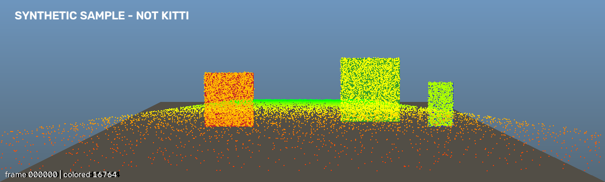
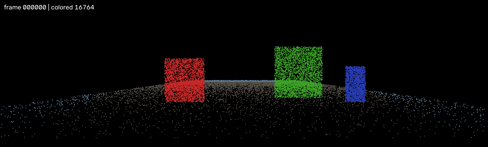
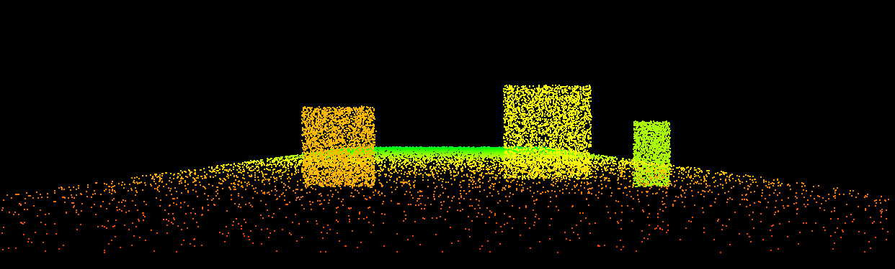

# M2 投影融合 — 完成验证

> 完成日期：2026-11-07
> 对应任务：T2.1 投影核心、T2.2 OpenMP 取色、T2.3 策略模式、T2.4 叠加图/点云视图、T2.5 PCD 落盘
>
> 注：M2 完成时使用 7,500 点样例；M3 将样例扩充到 20,000 点（含相机后方的 360° 环）并复跑。本页数字与截图使用当前 20,000 点样例；M2 的核心测试仍为 9 个，全部通过。

---

## 1. 结论

M2 已完成。当前项目可以：

- 将 Velodyne 3D 点云通过 `P2 · R0_rect · Tr_velo_to_cam` 投影到 2D 像素；
- 自动过滤相机后方、过近、过远和图像边界外的点；
- 用 OpenMP 并行完成投影和图像取色，1/4 线程结果一致；
- 生成带 RGB 的 3D 点云（仍保持 Velodyne 坐标系）；
- 输出深度着色的 `overlay.png` 和 RGB 着色的 `fused_view.png`；
- 输出二进制 `fused.pcd`，字段为 `x y z rgb`；
- 支持 `pinhole` 和 `depth` 两种融合策略，并预留退化动作到策略的映射。

---

## 2. 新增代码

| 文件 | 内容 |
|---|---|
| `include/fusion/Projection.h` / `src/fusion/Projection.cpp` | 纯 Eigen 投影核心，标量 + OpenMP 批量 |
| `include/fusion/FusionOptions.h` | 深度范围、线程数、插值方式 |
| `include/fusion/PinholeFusionStrategy.h` / `.cpp` | 正常 RGB 取色 + 并行融合 |
| `include/fusion/DepthOnlyFusionStrategy.h` / `.cpp` | 图像不可用时的深度伪彩色 |
| `include/fusion/FusionStrategyFactory.h` / `.cpp` | 策略工厂 + 退化动作映射 |
| `include/viz/OverlayRenderer.h` / `.cpp` | 深度着色叠加图 + RGB 融合点云视图 |
| `include/io/ImageWriter.h` / `.cpp` | 非 ASCII 路径安全的 PNG 写出 |
| `include/io/PcdWriter.h` / `.cpp` | PCD 二进制写出 + 临时路径绕开 PCL 的 Unicode 路径问题 |
| `tools/fuse_frame.cpp` | 单帧融合驱动工具 |
| `tests/test_projection.cpp` | 投影数学/边界/线程一致性 |
| `tests/test_fusion.cpp` | 取色/双线性/线程一致/策略工厂 |
| `tests/test_overlay.cpp` | 叠加图与融合视图 |
| `tests/test_pcd_roundtrip.cpp` | PCD 读写回环 |

---

## 3. 构建与测试

```powershell
$cmake = "C:\Program Files (x86)\Microsoft Visual Studio\2022\BuildTools\Common7\IDE\CommonExtensions\Microsoft\CMake\CMake\bin\cmake.exe"
$pcl   = "C:\Users\ydyyy\Documents\deepseek-harness\default-workspace\_deps\pcl"
$cv    = "C:\Users\ydyyy\Documents\deepseek-harness\default-workspace\_deps\opencv\opencv\build"
$eigen = "C:\Users\ydyyy\Documents\deepseek-harness\default-workspace\_deps\pcl\3rdParty\Eigen3\share\eigen3\cmake"

& $cmake --preset vs2022 "-DCMAKE_PREFIX_PATH=$pcl;$cv" "-DEigen3_DIR=$eigen"
& $cmake --build --preset vs2022-release
powershell -ExecutionPolicy Bypass -File .\scripts\test.ps1
```

结果：

```text
1/9 smoke ............ Passed
2/9 calibration ...... Passed
3/9 kitti_source ..... Passed
4/9 data_integration . Passed
5/9 projection ....... Passed
6/9 fusion ........... Passed
7/9 overlay .......... Passed
8/9 pcd_roundtrip .... Passed
9/9 deps_check ....... Passed

100% tests passed, 0 tests failed out of 9
```

另执行了 `cmake --build build --config Release --clean-first` 全量重编译，再跑 CTest，仍为 9/9 通过。

---

## 4. 投影核心验证

`tests/test_projection.cpp` 覆盖：

- `P2 = [100,0,50; 0,100,40; 0,0,1]`、单位外参时：
  - `(0,0,10)` → `u=50, v=40, depth=10`；
  - 相机后方的点被拒绝；
  - 图像外的点被拒绝；
  - `depth < min_depth`、`depth > max_depth` 被拒绝；
- 批量投影与单点投影一致；
- 1 线程与 4 线程的 `valid/u/v/depth` 逐点一致；
- 非法图像尺寸/深度范围抛异常。

---

## 5. 融合验证

`tests/test_fusion.cpp` 覆盖：

- 已知点 `(1,0,10)` 投影到像素 `(5,4)`，采样 BGR 为 `(50,40,45)`；
- 双线性采样：3×3 图像中心 `(0.5,0.5)` 采样为 `(25,25,25)`；
- 无效投影点被丢弃；
- 81 点网格在 1 线程和 4 线程下输出颜色逐点一致；
- `pinhole` / `depth` 策略工厂；
- `FULL_FUSION → pinhole`、`GEOMETRY_ONLY → depth-only`；
- 未知策略名抛异常。

---

## 6. 样例运行

```powershell
powershell -ExecutionPolicy Bypass -File .\scripts\fuse_frame.ps1
```

输出：

```text
source: KittiDataSource
frame: 000000
degradation: FULL_FUSION (overall=0.684623, 6.30 ms)
strategy: auto(FULL_FUSION)
input points: 20000
projected points: 16764
colored points: 16764
elapsed: 30.61 ms
output dir: results
degradation json: 000000_degradation.json
overlay: 000000_overlay.png
fused view: 000000_fused_view.png
pcd: 000000_fused.pcd
```

连续 3 次约为 31.83 / 30.07 / 30.61 ms。M2 的 `fuse_frame` 现在也接入 M3 退化评估，因此耗时包含退化评估、融合、渲染和 PNG/PCD 写盘，不含数据读取。

### 6.1 投影叠加图



叠加图用**深度伪彩色**绘制点云（不是为了替换原图颜色），这样在真实 KITTI 图像上更容易检查点云边缘是否贴合物体边缘。当前样例是合成数据，三个矩形分别对应三个不同深度的相机朝向表面；`scripts/make_sample_fixture.py` 已改为从像素反投影生成这三个表面，因此叠加图可以直接检查投影链路是否对齐。

### 6.2 融合点云视图



`fused_view` 用原图像素给点云上色，黑色背景，保留 RGB 结果。该图就是后续三联图中的“中间”图。

### 6.3 PCD

```text
# .PCD v0.7
FIELDS x y z rgb
SIZE 4 4 4 4
TYPE F F F U
WIDTH 16764
HEIGHT 1
POINTS 16764
DATA binary
```

PCD 保持 Velodyne 坐标系，RGB 字段由 `PointXYZRGB` 写入；`test_pcd_roundtrip` 已验证读写回环。

---

## 7. 深度模式

```powershell
powershell -ExecutionPolicy Bypass -File .\scripts\fuse_frame.ps1 -Mode depth -Out results_depth
```

输出：

```text
strategy: depth
input points: 20000
projected points: 16764
colored points: 16764
```

深度模式下不读取图像颜色，按距离从近（暖色）到远（冷色）着色；用于图像退化时的降级展示。该目录是验证输出，不属于默认 `results/`。



---

## 8. 验收清单

| 验收项 | 状态 | 证据 |
|---|---|---|
| 3D → 2D 投影 | 通过 | `projection` 测试已知点 |
| 深度/边界过滤 | 通过 | `projection` 测试 |
| 单点与批量一致 | 通过 | `projection` 测试 |
| OpenMP 线程一致 | 通过 | 1/4 线程比对 |
| 图像双线性取色 | 通过 | `(25,25,25)` 测试 |
| 无效点丢弃 | 通过 | `fusion` 测试 |
| 策略模式 | 通过 | `FusionStrategyFactory` 测试 |
| 深度降级策略 | 通过 | `depth` 模式输出 |
| 叠加图 | 通过 | `000000_overlay.png` |
| 融合点云视图 | 通过 | `000000_fused_view.png` |
| PCD 落盘/回读 | 通过 | `pcd_roundtrip` 测试 |
| 非 ASCII 路径 | 通过 | 项目路径含中文，PNG/PCD 均写出成功 |

---

## 9. 已知限制

1. **样例是合成数据**，不是真实 KITTI；叠加图的对齐只能证明投影链路和代码路径正确，真实 KITTI 帧还需要替换 `data/sample` 后再做一次目视验收。
2. **叠加图使用深度伪彩色**，不是原始 RGB；这样更易看出投影点，但视觉上不等于“原图上直接贴 RGB 点”。`fused_view` 保留 RGB。
3. **PCD 只包含有效投影点**（16764/20000），不是原始完整点云；后续 M4 的栅格化应使用原始点云，避免丢失视场外/无效点。
4. **PNG/PCD 写出使用临时路径/内存编码**，避免 Windows 非 ASCII 路径问题；M5/M6 可统一为 ResultWriter。
5. **尚未做退化评估和策略自动选择**；当前 `--mode` 手动指定，M3 会用 `DegradationReport.action` 驱动工厂。
6. **尚未做 BEV 栅格**；M4 实现。
7. **耗时 20ms 包含融合、渲染和写盘**，不是纯投影 compute 时间；M6 会拆分统计。

---

## 10. 下一步（M3）

M3 退化评估：

```text
T3.1 图像指标：均值/标准差/熵/暗像素/过曝
T3.2 点云指标：近场点数/方位覆盖/FOV 点数
T3.3 报告聚合 + degradation.json
```

M3 完成后，`FusionStrategyFactory::createForAction()` 将由真实退化报告驱动，而不是手动 `--mode`。
