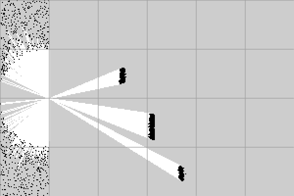

# M4 空间表征 — 完成验证

> 完成日期：2026-11-07
> 对应任务：T4.1 预处理/体素降采样、T4.2 BEV 占据栅格、T4.3 PGM/YAML、T4.4 栅格预览与统计

---

## 1. 结论

M4 已完成。当前项目可以：

- 对原始点云做 ROI 裁剪和高度过滤；
- 用 PCL `VoxelGrid` 做体素降采样；
- 生成 2D BEV 占据栅格（occupied / free / unknown）；
- 用 2D 射线投射标记 free space；
- 输出 `PGM + YAML`（map_server 语义）；
- 输出栅格预览 PNG 与 occupied/free/unknown 统计；
- 支持障碍物膨胀（可选）。

---

## 2. 新增代码

| 文件 | 内容 |
|---|---|
| `include/mapping/PointCloudPreprocessor.h` / `.cpp` | ROI、高度过滤、PCL VoxelGrid |
| `include/mapping/BevOccupancyGrid.h` / `.cpp` | BEV 坐标映射、占据、Bresenham 射线、膨胀 |
| `include/io/OccupancyMapWriter.h` / `.cpp` | PGM P5 + YAML |
| `include/viz/OccupancyMapRenderer.h` / `.cpp` | 栅格预览 + 10m 网格线 |
| `tools/map_frame.cpp` | 单帧空间表征驱动 |
| `tests/test_preprocess.cpp` | ROI/高度/体素统计 |
| `tests/test_bev_grid.cpp` | 坐标、free/unknown、遮挡、膨胀 |
| `tests/test_map_io.cpp` | PGM/YAML 读写 |
| `tests/test_grid_render.cpp` | 颜色、尺寸、错误路径 |

---

## 3. 测试结果

```text
1/16 smoke ............ Passed
2/16 calibration ...... Passed
3/16 kitti_source ..... Passed
4/16 data_integration . Passed
5/16 projection ....... Passed
6/16 fusion ........... Passed
7/16 overlay .......... Passed
8/16 pcd_roundtrip .... Passed
9/16 image_degradation  Passed
10/16 lidar_degradation Passed
11/16 degradation_report Passed
12/16 preprocess ...... Passed
13/16 bev_grid ........ Passed
14/16 map_io .......... Passed
15/16 grid_render ..... Passed
16/16 deps_check ...... Passed

100% tests passed, 0 tests failed out of 16
```

另执行了 `cmake --build build --config Release --clean-first` 全量重编译，再跑 CTest，仍为 16/16 通过。

---

## 4. 样例运行

```powershell
powershell -ExecutionPolicy Bypass -File .\scripts\build_map.ps1
```

输出：

```text
source: KittiDataSource
frame: 000000
input points: 20000
roi points: 17785
height points: 6779
downsampled points: 3521
grid: 300x200 @ 0.2 m
occupied: 1060
free: 7108
unknown: 51832
raycast: true
elapsed: 11.29 ms
output dir: results
pgm: 000000_occupancy.pgm
yaml: 000000_occupancy.yaml
preview: 000000_occupancy.png
```

连续 3 次约 11.03 / 11.36 / 10.87 ms，单次最后运行为 11.29 ms；整体约 10.9–11.4 ms。包含预处理、栅格化、PGM/YAML 和 PNG 预览写出。

### 4.1 预览图



- 黑色：occupied
- 白色：free（射线经过）
- 灰色：unknown（未观测/被遮挡）
- 浅灰线：10m 网格

### 4.2 `occupancy.yaml`

```yaml
image: 000000_occupancy.pgm
resolution: 0.2000
origin: [-10.0000, -20.0000, 0.0000]
negate: 0
occupied_thresh: 0.65
free_thresh: 0.196
frame_id: velodyne
height_min: -1.5000
height_max: 2.5000
raycast: true
inflation_cells: 0
```

### 4.3 PGM

```text
P5
300 200
255
```

像素值：`0 = occupied`、`254 = free`、`205 = unknown`。第 0 行对应 `y_max`，`origin` 为左下角；这是后续接入 map_server / 规划器时必须保持的约定。

---

## 5. 预处理

默认参数：

```text
ROI: x [-10, 50] m, y [-20, 20] m, z [-1.5, 2.5] m
voxel: 0.2 m
```

样例统计：

| 阶段 | 点数 |
|---|---:|
| 输入 | 20,000 |
| ROI 内 | 17,785 |
| 高度带内 | 6,779 |
| 体素降采样后 | 3,521 |

高度过滤是近似地面去除：KITTI 地面点通常在 `z ≈ -1.7m`，默认 `z_min=-1.5` 可滤掉大部分地面。它不是 RANSAC 平面分割，坡道/颠簸路面需要调参。

---

## 6. BEV 栅格

坐标映射：

```cpp
col = floor((x - x_min) / resolution);
row = floor((y_max - y) / resolution);   // 第 0 行 = y_max
```

Raycast：

- 以传感器原点 `(0,0)` 的栅格为起点；
- 对每个 occupied cell 做 2D Bresenham；
- 途经的未知 cell 标记为 free；
- 如果射线先撞到其他 occupied cell，立即停止，不把障碍物后方错误标成 free；
- 目标 cell 保持 occupied。

膨胀：`--inflation <n>` 使用 Chebyshev 半径，把 occupied 邻域标记为 occupied；默认 0。

---

## 7. 验收清单

| 验收项 | 状态 | 证据 |
|---|---|---|
| ROI/高度过滤 | 通过 | `preprocess` 测试 |
| PCL 体素降采样 | 通过 | 2 点合并为 1 点 |
| BEV 尺寸/原点/行列方向 | 通过 | `bev_grid` 测试 |
| free/unknown 标记 | 通过 | 射线路径测试 |
| 遮挡后方不误标 free | 通过 | 近障碍 + 远点测试 |
| 障碍物膨胀 | 通过 | `inflation_cells=1` 测试 |
| PGM 像素值/尺寸 | 通过 | `map_io` 测试 |
| YAML 字段 | 通过 | 分辨率/原点/阈值/frame_id |
| 栅格预览颜色 | 通过 | `grid_render` 测试 |
| 单帧工具 | 通过 | `build_map.ps1` |

---

## 8. 已知限制

1. **高度过滤是近似地面去除**，没有 RANSAC；坡道、悬挂物、低矮障碍可能需要调 `z_min/z_max`。
2. **Raycast 是 2D 近似**，不建模 LiDAR 光束高度/入射角；free space 只用于演示规划器输入语义。
3. **没有 ROS 运行时**，只保证 PGM/YAML 与 map_server 的字段/坐标约定一致；真实 `map_server` 加载未在本机验证。
4. **样例是合成数据**，地图形态只用于验证语义；真实 KITTI 需要替换 `data/sample` 后再做目视验收。
5. **没有多帧累积**；当前每帧独立生成栅格，M6/后续可做序列累积。
6. **未做地图精度指标**（IoU/Chamfer）；M6 可补。

---

## 9. 下一步（M5）

M5 管线集成：

```text
T5.1 Pipeline 编排 + CLI
T5.2 耗时采集 + summary.csv
T5.3 错误处理/日志/退出码
T5.4 端到端集成测试
```

M5 会把 `inspect_frame` / `fuse_frame` / `build_map` 收敛为一条 `lidar_fusion` 命令，并输出 `timing.json` 与 `summary.csv`。
