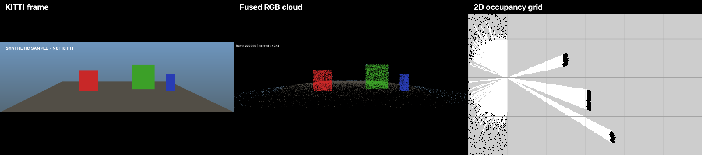

# M6 验证交付 — 完成记录

> 完成日期：2026-11-07
> 对应任务：T6.1 性能/内存、T6.2 README/三联图、T6.3 repo polish、T6.4 最终验收/tag

---

## 1. 结论

M6 完成，`v0.1.0` 可交付。

- CTest：17/17 通过；
- 干净全量重编译：通过；
- 单帧/三帧/十帧 Pipeline：通过；
- 性能目标：compute 2.50 ms、end-to-end 43.98 ms，均达标；
- 三联图、性能文档、验收清单完成；
- MIT 许可证、`.clang-format`、可选 Ubuntu CI 添加；
- Git 仓库初始化并打 `v0.1.0` tag。

---

## 2. 三联图



生成脚本：

```powershell
python .\scripts\make_compare.py `
  --image .\data\sample\image_2\000000.png `
  --fused .\results\000000_fused_view.png `
  --grid .\results\000000_occupancy.png `
  --out .\results\000000_compare.png
```

图：左 KITTI 风格原图，中融合 RGB 点云，右 2D BEV 栅格。

---

## 3. 性能/内存

详见 [performance.md](performance.md)。

| 指标 | 结果 |
|---|---:|
| compute 中位数（全输出） | 2.50 ms |
| end-to-end 中位数（全输出） | 43.98 ms |
| end-to-end p95（全输出） | 45.84 ms |
| compute 中位数（no-viz/no-pcd） | 1.94 ms |
| 峰值 working set（10 帧） | ≈ 33 MB |
| 1/2/4/8 线程 fusion 中位数 | 0.641/0.488/0.465/0.364 ms |

**ASan/Valgrind 结果：**

- 使用 `/EHsc /fsanitize=address /Zi` 成功构建 ASan 版本；
- `lvf_test_pipeline.exe` 在 ASan 下通过；
- `lidar_fusion --all --no-viz --no-pcd` 处理 10 帧，退出码 0，无 ASan 报错；
- Windows 版 MSVC ASan 不支持 `detect_leaks`，本机无 Valgrind；泄漏检测留给 Linux CI 补跑。

---

## 4. Repo polish

| 文件 | 内容 |
|---|---|
| `LICENSE` | MIT（代码）；KITTI 数据另许 |
| `.clang-format` | Google 风格，4 空格，100 列 |
| `.github/workflows/ci.yml` | Ubuntu 22.04 + OpenCV/Eigen/PCL/OpenMP 构建测试 |
| `.gitignore` | build/results/大依赖/日志 |
| `README.md` | 三联图、快速开始、性能摘要、限制 |
| `docs/performance.md` | 10 帧统计、线程扩展、内存 |
| `docs/acceptance.md` | 最终验收清单 |

---

## 5. 最终验收

完整清单见 [acceptance.md](acceptance.md)。

关键结果：

- 单帧命令退出码 0；
- 8 类结果文件 + summary.csv；
- 退化 action 驱动融合策略；
- 栅格 PGM/YAML 语义正确；
- `--all` 三帧/十帧可运行；
- 退出码 0/1/2/3 验证；
- 17 项 CTest 全部通过；
- compute/end-to-end 性能目标达成；
- ASan 内存错误检查通过（pipeline 测试 + 10 帧 CLI）。

未完成项仅限 Windows ASan 泄漏检测/Valgrind（平台限制，已记录）。

---

## 6. Git

仓库初始化并提交：

```text
branch main
tag    v0.1.0
```

`v0.1.0` tag 指向 `main` 的最终提交；`git show v0.1.0` 可查看完整交付快照。

提交内容共 113 个文件，不包含 `build/`、`results/`、`results_depth/`、本地依赖。KITTI 全量数据未提交；`data/sample` 为合成 fixture。

---

## 7. 交付物入口

- [README.md](../README.md)
- [acceptance.md](acceptance.md)
- [performance.md](performance.md)
- [interfaces.md](interfaces.md)
- [TASKS.md](../TASKS.md)
- `results/000000_compare.png`
